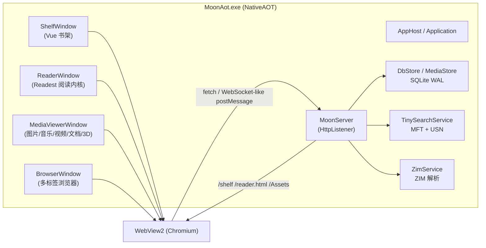

# 架构设计

## 1. 总览

MoonAot 是“单进程、多窗口、内嵌 HTTP 服务 + WebView2 前端”的桌面应用：

- **UI 线程**：Win32 窗口、WebView2、DirectComposition；所有原生窗口操作必须在 UI 线程。
- **HTTP 线程池**：`HttpListener` 只监听 `127.0.0.1` 随机端口，前端与阅读器通过同源 HTTP 访问数据。
- **后台任务**：索引扫描、封面补齐/压缩、导入、缩略图生成、网站抓取等。
- **持久化**：SQLite（WAL）保存结构化数据；封面/缩略图/缓存/日志使用文件系统。

## 2. 原生模块

| 模块 | 职责 |
|---|---|
| `Win/AppWindows.cs` | 窗口注册、打开阅读器/播放器/浏览器、文件类型分发（`OpenTarget`）、引导与退出 |
| `Win/WebViewWindowBase.cs` | WebView2 宿主、窗口状态、脚本注入、消息桥（`chrome.webview.postMessage`） |
| `Win/ShelfWindow.cs` | 书架窗口、导入对话框、宏热键、路由补发（`ready` 握手） |
| `Win/ReaderWindow.cs` | 阅读器窗口、上下键切书、进度写入 |
| `Win/MediaViewerWindow.cs` | 统一媒体/文档查看器窗口（路由 `/view/:kind`） |
| `Win/BrowserWindow.cs` | 多标签浏览器、地址栏、开发者工具、注入脚本 |
| `Server/MoonServer*.cs` | 静态资源、书籍/媒体流、JSON API、TinySearch/ZIM/Wiki 路由 |
| `Store/Database.cs` | SQLite 建表、迁移（`EnsureColumn`）、索引 |
| `Store/DbStore.cs` | 书籍/设置/笔记/进度/宏/收藏的 SQL 访问与内存版本号 |
| `Store/MediaStore.cs` | 媒体进度、播放列表 |
| `Services/LibraryService.cs` | 导入、元数据、封面/缩略图、后台维护任务 |
| `Services/ThumbnailService.cs` | GDI+ 缩略图、封面压缩（≤48KB / ≤40KB） |
| `Services/EpubRepairService.cs` | EPUB `container.xml` 路径大小写修复缓存 |
| `Services/ImageScanService.cs` | 图片文件夹索引、后台扫描、分页 |
| `Services/Zim/*` | ZIM 头/条目/簇解析、zstd/xz、OpenCC 简繁转换 |
| `TinySearch/*` | MFT 扫描、紧凑 EntryStore、Everything 查询、USN/FSW 实时监控 |

## 3. 前端架构

- `frontend/src/views/ShelfView.vue`：书架查询、筛选、虚拟网格数据窗口、导入进度。
- `components/VirtualGrid.vue`：固定行高虚拟滚动，仅渲染可视区 + 3 行 overscan，最多 60 行 DOM。
- `views/viewer/*`：图片、音乐、视频、压缩包、代码、Word、表格、PPT、3D、CAD、图片编辑器。
- `views/ViewerHost.vue`：按 `kind` 懒加载查看器组件。
- `host.ts`：WebView2 消息桥；`installHostBridge` 暴露 `window.__host`，包括 `openTarget/openViewer/openBrowser`。
- `api.ts`：所有 HTTP API 与资源 URL。

## 4. HTTP 路由

| 路由 | 说明 |
|---|---|
| `/shelf/*` | Vue 书架静态资源 |
| `/reader.html` | Readest 阅读器入口（`?ids=hash`） |
| `/book/{id}` | 原始书籍流，支持 HTTP Range；EPUB 会先走兼容修复 |
| `/txt/{id}`、`/md/{id}` | TXT/MD 解码为 UTF-8 |
| `/cover/{id}`、`/thumb/{id}` | 封面与书架缩略图 |
| `/media`、`/image` | 音视频/图片流（支持 Range） |
| `/thumbpath` | 任意文件缩略图（媒体/压缩包） |
| `/api/library/page` | 书架分页（支持 `count=0` 跳过 COUNT） |
| `/api/library/facets` | 格式/作者/文件夹聚合 |
| `/api/library/importPaths` | 批量导入路径 |
| `/api/media/progress` | 媒体进度（含图片缩放/旋转） |
| `/api/filetext` | 文本读取/保存（编码保持） |
| `/api/imageedit` | 图片编辑器保存副本/覆盖 |
| `/tiny/`、`/tiny/api/*` | 全盘搜索 UI 与 API |
| `/zimapi/*`、`/zim/*`、`/wiki/` | ZIM 信息/搜索/内容与维基 UI |
| `/site/*`、`/api/sites/*` | 本地网站托管 |
| `/empty-font.css` | 阅读器远程字体的本地空样式（避免网络阻塞） |

## 5. 数据模型（核心表）

- `books`：id、标题、作者、路径、格式、大小、封面、文件夹、收藏、进度、最近阅读。
- `configs`：每本书的阅读配置（主题、字体、PDF 布局等）。
- `notes`：划线/笔记/书签。
- `app_settings`：单行设置（主题、排序、窗口位置、媒体设置、封面维护字段）。
- `media_progress`：音视频/图片文件夹进度、缩放、旋转。
- `playlists`、`macros`、`favorites`：播放列表、宏、收藏夹。
- 索引：`COALESCE(last_read_at, added_at)` 表达式索引，`title/author/format/folder/file_size` 组合索引。

## 6. 性能设计

1. **书架**：120 本/页，虚拟滚动，翻页跳过 COUNT；最近阅读使用表达式索引，深偏移稳定在 10ms 级。
2. **封面**：导入/启动后台提取，压缩到 ≤48KB；书架缩略图 320×480、≤40KB；滚动不再触发书籍解析。
3. **索引**：NTFS 优先读 MFT；USN Journal 实时增量；非 NTFS 递归扫描 + FileSystemWatcher；移动盘热插拔。
4. **图片**：有全盘索引时直接枚举 EntryStore 子树，否则回退文件系统扫描。
5. **阅读器**：禁用远程字体样式；EPUB 首次打开时按需生成容器修复副本并缓存。
6. **AOT**：JSON 全部源生成；SQLite 原生 SQL；不使用反射序列化与动态代码生成。

## 7. 安全边界

- HTTP 仅绑定 `127.0.0.1`，不对外网开放。
- 静态资源、站点托管、文本/图片保存均做路径规范化与根目录校验。
- 图片编辑只写入原图同目录或覆盖原文件（需确认）。
- 不上传任何用户数据；发布包不包含 `data`。
